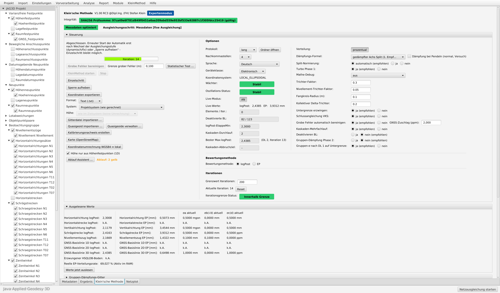

# Klein'sche Methode für JAG3D

**Automatische, nachvollziehbare Kalibrierung des stochastischen Modells in der geodätischen Netzausgleichung – als Erweiterung für [JAG3D (Java·Applied·Geodesy·3D)](https://software.applied-geodesy.org).**

Verfasser: **Dipl.-Ing. (FH) Stefan Klein** · Version **V1.00 RC3** · Lizenz **GNU GPL v3**

> **Hinweis:** Dies ist eine **inoffizielle Erweiterung** von JAG3D. Sie wird vom Autor von JAG3D, Michael Lösler, weder entwickelt noch unterstützt oder geprüft. Fragen und Fehlermeldungen bitte ausschließlich hier über die [Issues](https://github.com/htw9056/jag3d-klein-methode/issues) stellen, nicht im JAG3D-Forum.

---

## Worum geht es?

In jeder Netzausgleichung entscheidet das stochastische Modell – die angesetzten Genauigkeiten der Beobachtungen und Anschlusspunkte – darüber, wie Messungen gewichtet, grobe Fehler aufgedeckt und Genauigkeiten der Ergebnisse angegeben werden. In der Praxis wird es meist von Hand und schrittweise angepasst: Varianzkomponenten schätzen, auffällige Beobachtungen prüfen, Anschlusspunkte bewerten, neu rechnen. Das kostet Zeit und hängt stark von der Erfahrung des Bearbeiters ab.

Die **Klein'sche Methode** führt diesen Weg in drei Stufen geführt und protokolliert durch:

1. **Freie Ausgleichung** – Kalibrierung der Messungen: Gruppengenauigkeiten werden iterativ und gedämpft nachgeführt (Varianzkomponentenschätzung mit Untergrenzen je Geräteklasse), danach werden einzelne Beobachtungen anhand ihrer Teststatistik so lange abgewichtet, bis jede für sich unauffällig ist (feste Grenze |logPost| ≤ 2,45 je Beobachtung).
2. **Dynamische Ausgleichung** – Analyse der Anschlusspunkte: Die Anschlusspunkte werden stochastisch eingeführt und ihre Genauigkeiten kalibriert. Punkte, die mit den vorhandenen Messungen nicht prüfbar sind, werden ausdrücklich so ausgewiesen.
3. **Fixe Ausgleichung** – abschließende Kalibrierung der Messungen mit den geprüften Anschlusspunkten.

Die Erweiterung nutzt ausschließlich die vorhandenen Rechen- und Testverfahren von JAG3D (Teststatistiken, Redundanzanteile, Varianzkomponenten); der Ausgleichungskern bleibt unverändert.

**Einordnung:** Das Abwichten einzelner Beobachtungen ist im Kern eine **robuste Schätzung** (iterativ umgewichtete kleinste Quadrate, vgl. Wicki 1998; verwandt mit der Dänischen Methode). Es wirkt damit implizit auch auf die Beobachtungen, auch wenn keine Messwerte in der Datenbank verändert werden. Die Automatik ersetzt keine fachliche Netzanalyse – sie nimmt die Routinearbeit ab, benennt Auffälligkeiten mit Ursache und legt jeden Schritt offen, damit der Bearbeiter entscheiden kann.

## Funktionen

- **Dreistufige Kalibrierung** (frei → dynamisch → fix) mit Abbruchkriterium, Wächter gegen Schwingen und Kaskaden-Mehrfachlauf
- **Grobe Fehler** werden ohne Eingriff erkannt und entschärft, mit Angabe der Beobachtung und der Fehlergröße
- **GNSS-Massendaten:** Epochen-Basislinien (z. B. alle 5 s über 30 min) werden vor der ersten Ausgleichung je Punktpaar robust zusammengefasst – getestet mit über 300 000 Basislinien
- **Wiederholte Messungen** je Messart zusammenfassen, regewichten oder kalibrieren
- **Plausibilitätsprüfungen** beim Import: Näherungskoordinaten (auch für Netze mit GNSS), Projektion, Höhensysteme, GNSS-Stützung am Netzrand
- **Koordinatenumrechnung** WGS84 ↔ lokales System
- **Gitterdateien** (z. B. GCG2016) für die Umrechnung zwischen ellipsoidischen Höhen und Normalhöhen
- **Koordinatenexport** in vielen Varianten, z. B. ETRS89/UTM, Gauß-Krüger oder eigene Systeme mit NTv2-Gitterdatei
- **Karte:** Netzplot auf OpenStreetMap-Hintergrund mit Punkten, Beobachtungslinien und Konfidenzellipsen
- **Protokoll** jedes Schritts, Kalibrierungsnachweis, Importbericht, Ablauf-Assistent
- **Hilfe** (F1) und Oberfläche in 7 Sprachen: Deutsch, Englisch, Französisch, Spanisch, Portugiesisch, Polnisch, Tschechisch
- optional **Schwarmwissen:** anonyme Laufberichte (ohne Koordinaten, Punkt- oder Projektnamen) und daraus abgeleitete Erfahrungswerte, siehe [schwarmwissen](schwarmwissen)

## Erprobung

- Synthetische Netze mit bekannter Wahrheit: Nivellement, 2D-Lage, 3D-Tachymeter, GNSS, kombinierte Netze, Netze mit groben Fehlern und mit Massendaten.
- Elf reale Projekte aus der Praxis: Tachymeternetze, GNSS-Netze und kombinierte Netze aus GNSS-Massendaten, Tachymeter und Nivellement mit bis zu 487 Neupunkten und über 300 000 GNSS-Basislinien. Alle erreichten in der fixen Stufe das Abbruchkriterium; die Ergebnisse stimmen mit der Handbearbeitung auf wenige Millimeter überein.

Die Vergleiche mit realen Daten beziehen sich auf die Bearbeitung von Hand, nicht auf eine unabhängige Kontrolle. Rückmeldungen mit eigenen Netzen – gern mit unabhängigen Kontrollmessungen – sind ausdrücklich erwünscht.

## Installation

Zwei Wege, ausführlich in [docs/INSTALLATION.md](docs/INSTALLATION.md):

- **Fertiges Programm (Windows):** unter [Releases](https://github.com/htw9056/jag3d-klein-methode/releases/latest) die Datei `JAG3D_Klein_Methode_V1.00_RC3_Windows.zip` herunterladen, entpacken und `jag3d.exe` starten. Das Paket enthält JAG3D mit der Klein'schen Methode samt Java – keine Installation nötig.
- **Fertiges Programm (Linux, macOS):** unter [Releases](https://github.com/htw9056/jag3d-klein-methode/releases/latest) `JAG3D_Klein_Methode_V1.00_RC3_Linux.zip` bzw. `…_MacOSX.zip` herunterladen, entpacken und `jag3d.sh` bzw. `jag3d.command` starten. Voraussetzung ist ein installiertes **Java 25 oder neuer**; JavaFX ist enthalten.
- **Aus den Quellen bauen:** Dieses Repository ist ein Fork von [applied-geodesy/jag3d](https://github.com/applied-geodesy/jag3d) mit bereits eingebauter Erweiterung. Repository herunterladen, den Ordner `JAG3D` in Eclipse importieren, übersetzen und als JAR exportieren.

Grundlage: JAG3D v20260906. Erforderlich ist Java 25 oder neuer (im Windows-Paket enthalten).

## Aufbau dieses Repositorys

| Ordner / Datei | Inhalt |
|---|---|
| `JAG3D` | JAG3D-Quelltext (Fork von applied-geodesy/jag3d) mit eingebauter Erweiterung |
| `JAG3D/src/org/applied_geodesy/klein_method` | Quelltext der Erweiterung (28 Klassen), Hilfe (7 Sprachen), Oberflächentexte (6 Sprachen) |
| `JAG3D/src/org/applied_geodesy/jag3d/ui/…` | vier angepasste JAG3D-Dateien, die den Reiter einbinden (siehe `NOTICE.md`) |
| `schwarmwissen` | optionaler Austausch von Erfahrungswerten: Vermittlungsdienst (Cloudflare Worker), GitHub-Action, Auswerteskript, Anleitungen |
| `docs` | Installation, Fachwörterbuch, Screenshot |
| `LICENSE` | GNU General Public License v3 |
| `NOTICE.md` | Urheber, Herkunft und Änderungen |

Das ursprüngliche JAG3D mit seiner Beschreibung: [applied-geodesy/jag3d](https://github.com/applied-geodesy/jag3d).

## Lizenz und Urheber

- **Klein'sche Methode** (Ordner `JAG3D/src/org/applied_geodesy/klein_method`, `schwarmwissen`, `docs`): © Dipl.-Ing. (FH) Stefan Klein, veröffentlicht unter der **GNU General Public License v3**.
- **JAG3D**: © Michael Lösler, [software.applied-geodesy.org](https://software.applied-geodesy.org), GNU GPL v3. Alle übrigen Dateien im Ordner `JAG3D` stammen aus JAG3D; vier davon wurden für die Einbindung geändert, die Änderung ist in jeder dieser Dateien vermerkt.

Die Software wird ohne jede Gewährleistung bereitgestellt (siehe LICENSE). Ergebnisse sind vor ihrer Verwendung fachlich zu prüfen.

---

### English summary

*Klein'sche Methode* is an **unofficial extension** of the least-squares adjustment software [JAG3D](https://software.applied-geodesy.org) by Dipl.-Ing. (FH) Stefan Klein. It calibrates the stochastic model automatically and traceably in three stages (free, dynamic with analysis of connection points, fixed): iterative variance component estimation with lower bounds, followed by robust down-weighting of individual observations until every observation passes its test (|logPost| ≤ 2.45). It also condenses GNSS mass baselines, checks imports, handles height grids and NTv2 grids, exports coordinates in many systems and shows the network on OpenStreetMap. User interface and help are available in seven languages. Licensed under GNU GPL v3; not developed or supported by the author of JAG3D.
